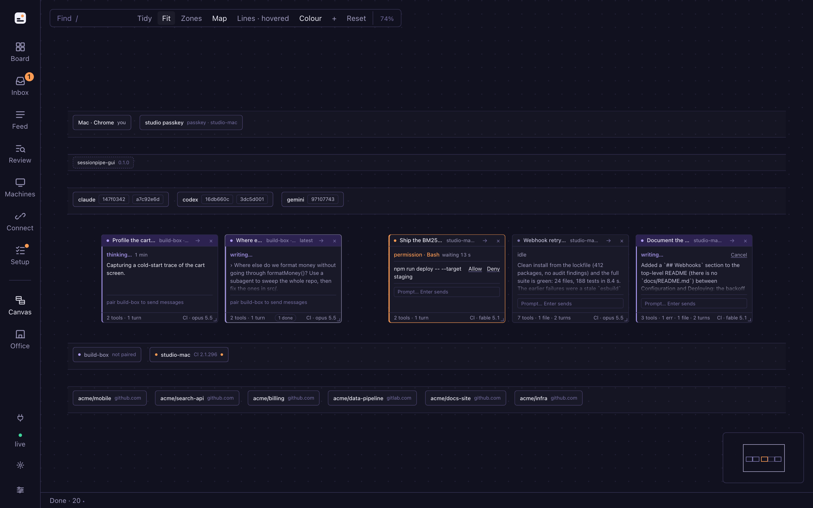
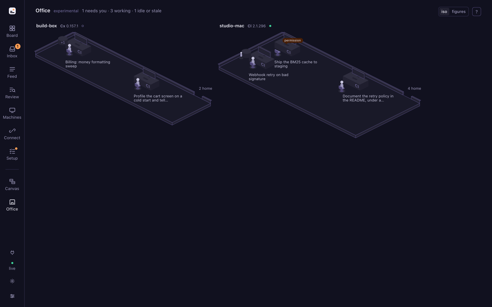
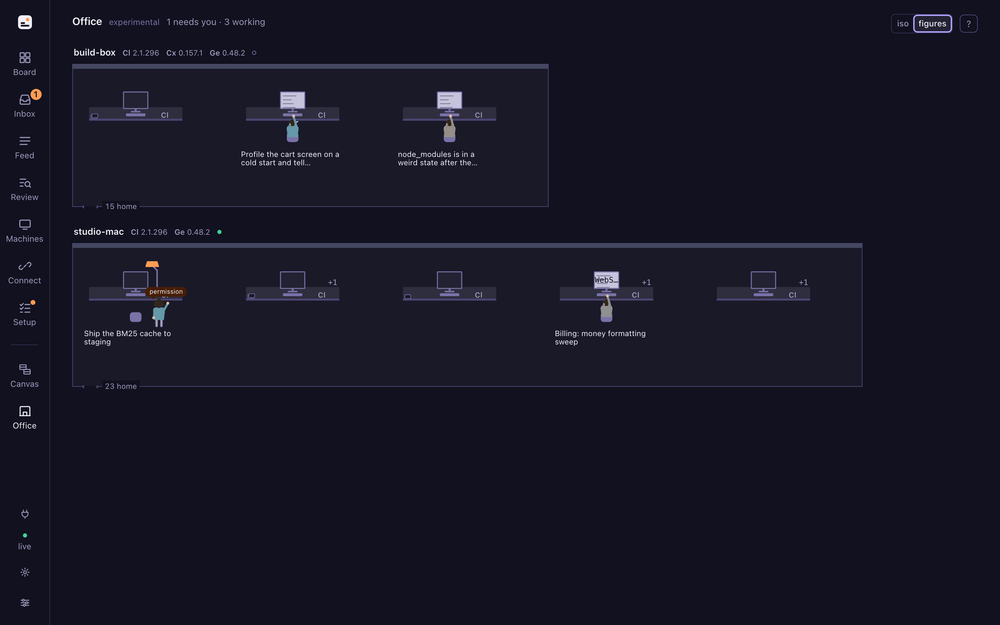
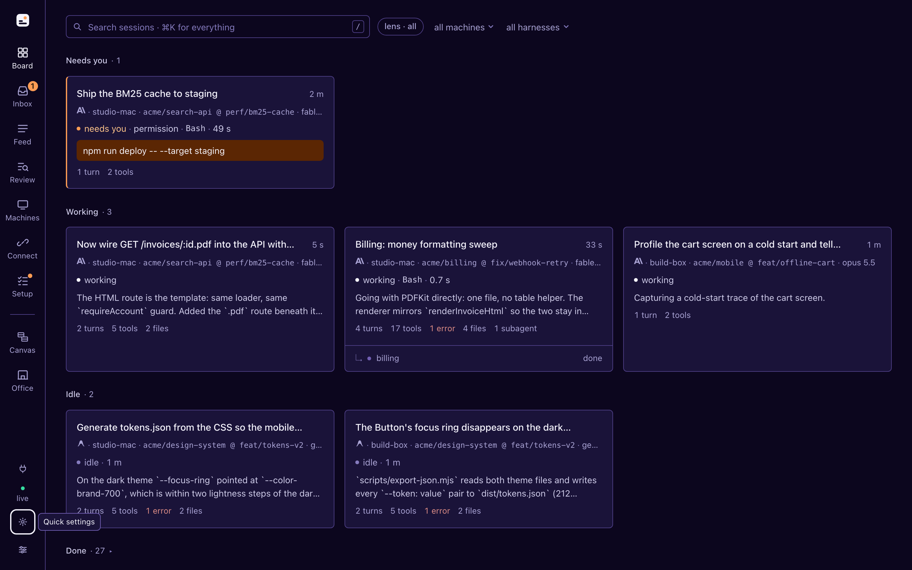
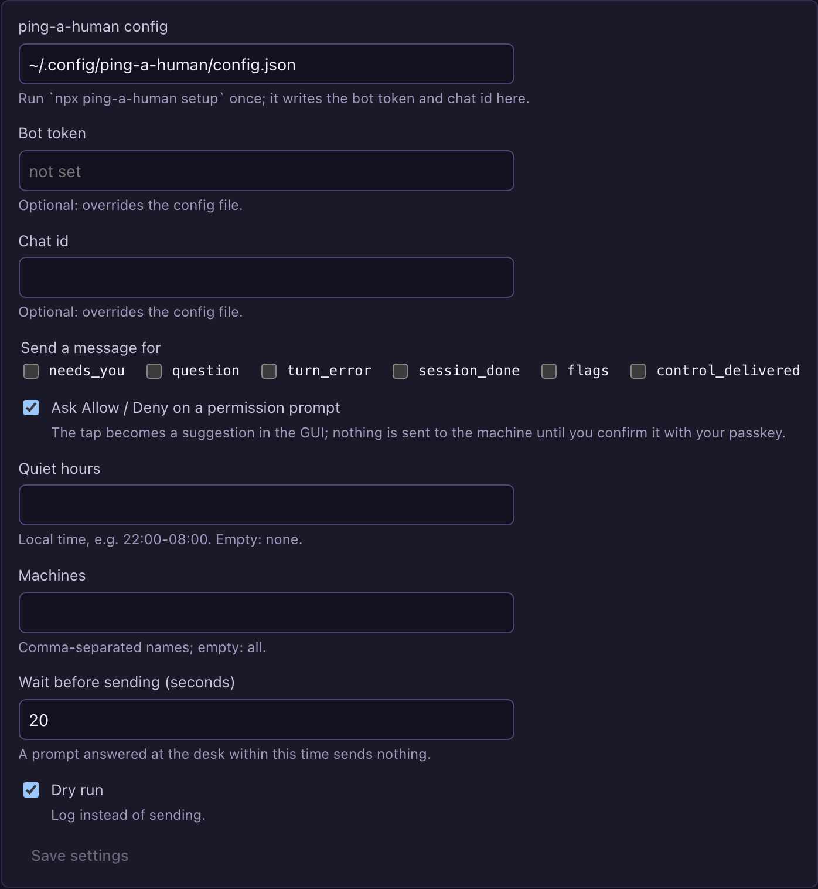

# sessionpipe-gui-themes

The official extensions for the [sessionpipe GUI](https://github.com/spacesheep-dev/sessionpipe-gui):
two **views** that draw the board their own way, three **skins**, the **color themes** the
skins grew out of, and one **plugin**. Each is a package the GUI loads at runtime through
a small contract: `ThemeApi` for a view, a `skin.json` of tokens, fonts and shape for a
skin, `PluginApi` for a plugin. The two views are bundled into the GUI's npm package at
build time, so a fresh `npx sessionpipe-gui` has them; everything else is installed with
one command. Apache-2.0, like the GUI.

## Packages

| Package | Kind | What it is |
|---|---|---|
| [`packages/canvas`](packages/canvas) | view, `/t/canvas` | Every live session as a window on an infinite canvas. Drag, resize, zoom; a **Map** draws the devices, accounts, machines and repos around the sessions in lanes; drag an account onto a machine to start a session there. Layout kept by the GUI, so it is the same on every device. Bundled with the GUI. Experimental. |
| [`packages/office`](packages/office) | view, `/t/office` | Every machine a room, every live session a person at a desk, every subagent a helper at a side table. Posture is the state, amber marks who needs you. An isometric floor by default, figures on request. Drawn with the host's React, so the bundle carries none. Bundled with the GUI. Experimental. |
| [`packages/skin-spacesheep`](packages/skin-spacesheep) | skin | The Spacesheep palette as one `skin.json`, both schemes in one entry. The GUI's default skin is `sessionpipe`; this installs like any skin, or is the starting point for a palette of your own. |
| [`packages/skin-spacesheep-vivid`](packages/skin-spacesheep-vivid) | skin | Spacesheep with the surfaces carrying the brand: deep indigo cards on a violet-black page, soft lavender on warm cream, lavender hairlines, a flame highlight for search marks. |
| [`packages/skin-paper-serif`](packages/skin-paper-serif) | skin | What a color theme cannot carry: a bundled serif (Source Serif 4, OFL) for the interface text, 2 px corners, one-pixel hairlines, roomier rows, on warm paper with a terracotta accent. Light only. Also holds `scripts/preview.mjs`, which renders any skin's `preview.png` against a GUI in demo mode. |
| [`packages/color-themes`](packages/color-themes) | color themes | The Spacesheep and Spacesheep Vivid palettes as plain token JSON (`<stateDir>/color-themes/*.json`), with the checker that verifies every text-on-ground ratio and the notes on where each colour comes from. |
| [`packages/plugin-ping-a-human`](packages/plugin-ping-a-human) | plugin | A Telegram message when a session needs you, through [ping-a-human](https://www.npmjs.com/package/ping-a-human). Allow / Deny buttons in the message come back to the GUI as a *suggestion* beside the prompt, which you confirm with your passkey. The plugin never answers anything itself. |
| [`packages/shared-types`](packages/shared-types) | types | A verbatim copy of the GUI's `shared/theme-api.ts`, `plugin-api.ts` and `api.ts`, so a package here type-checks without depending on the GUI. The GUI is the source of truth; copy, never edit. |

### Canvas



### Office

|  |  |
|---|---|

### Skins

|  |  |
|---|---|

### ping-a-human



## Install

On the machine that runs `sessionpipe-gui`. Canvas and Office are already in its package;
the rest come from npm, one line each, or all at once with `sessionpipe-gui extras add all`
(the Views page has the same list with buttons):

| Package | npm | Install |
|---|---|---|
| Canvas | `@sessionpipe-gui/theme-canvas` | bundled with the GUI (`sessionpipe-gui view add @sessionpipe-gui/theme-canvas` on an older GUI) |
| Office | `@sessionpipe-gui/theme-office` | bundled with the GUI |
| Spacesheep | `@sessionpipe-gui/skin-spacesheep` | `sessionpipe-gui skin add @sessionpipe-gui/skin-spacesheep` |
| Spacesheep Vivid | `@sessionpipe-gui/skin-spacesheep-vivid` | `sessionpipe-gui skin add @sessionpipe-gui/skin-spacesheep-vivid` |
| Paper Serif | `@sessionpipe-gui/skin-paper-serif` | `sessionpipe-gui skin add @sessionpipe-gui/skin-paper-serif` |
| ping-a-human | `@sessionpipe-gui/plugin-ping-a-human` | `npx ping-a-human setup` once, then `sessionpipe-gui plugin add @sessionpipe-gui/plugin-ping-a-human` and *Reload plugins* on the Views page |
| the types | `@sessionpipe-gui/theme-types` | `npm i -D @sessionpipe-gui/theme-types` in a package of your own |

From a checkout of this repo, `add` takes the folder instead (a `.tgz`/`.zip` or a git URL
work too), and a plain color theme is a file:

```sh
sessionpipe-gui skin add ./packages/skin-paper-serif
sessionpipe-gui plugin add ./packages/plugin-ping-a-human
cp packages/color-themes/spacesheep-vivid-dark.json ~/.local/state/sessionpipe-gui/color-themes/
```

A skin then appears under *Installed* in the appearance popover (the gear on the rail), no
restart; a plugin on the Views page with its settings form and its status (`active`, or
the reason it is not). A view is code running in the board page with everything the page
has; a plugin is code running in the receiver process with everything that machine has; a
skin runs no code. Install only what you trust.

## Working on a package

```sh
nvm use                      # Node 22 (.nvmrc); the GUI needs ≥ 20
npm install                  # workspaces
npm run build                # every package with a build: dist/index.js (+ dist/index.css for a view)
npm run typecheck
npm run lint                 # biome
npm test                     # canvas: Playwright against its harness; plugin: node:test; skins and color themes: the token checker
```

Link a package into a running GUI instead of copying it. A linked view is re-imported on
every visit to its page, a linked skin re-read on **Reload** and a linked plugin on
**Reload plugins**, so an edit shows without a restart. For the two bundled views, a link
of the same id takes precedence over the bundled copy while it is there:

```sh
sessionpipe-gui view link   $PWD/packages/canvas
sessionpipe-gui skin link   $PWD/packages/skin-paper-serif
sessionpipe-gui plugin link $PWD/packages/plugin-ping-a-human
```

Canvas has a dev harness that mounts it against a fake `ThemeApi` with a small world of
sessions, so it can be built before (and without) a running GUI: `npm run dev -w
packages/canvas` serves `http://127.0.0.1:7420/harness.html` (`?extra=50` adds sessions,
`?scheme=light`, `?tick=0` freezes the world). A skin's `preview.png` is rendered with
`npm run preview -w packages/skin-paper-serif -- ../skin-spacesheep-vivid` against a built
GUI checkout beside this repo.

### Layout of a package

```
packages/<id>/
  theme.json | skin.json | plugin.json   the manifest: id, name, version, api, and the kind's own fields
  package.json                           @sessionpipe-gui/<kind>-<id>; files: what the installer copies
  src/                                   a view: TypeScript + DOM, or TSX against the host's React (office)
  scripts/build.mjs                      esbuild → dist/index.js (one ES module) + dist/index.css
  fonts/, skin.css, preview.png          a skin: what its manifest points at; no code
  dev/, test/                            the fake host and the Playwright suite (canvas)
```

A plugin is bundled for Node (`--platform=node --format=esm`, dependencies in, since the
installer leaves `node_modules` out) with `"kind": "plugin"` and a `settings` list the GUI
draws a form from.

Rules of the house: hairlines, one typeface (the host's, unless a skin brings its own), the
host's colour tokens by name (`--bg`, `--fg`, `--fg-2`, `--fg-3`, `--line`, `--needs`,
`--err`, …) so a skin restyles every view at once, the *needs you* colour only for *needs
you*, `prefers-reduced-motion` honoured, a view's `dist/index.js` well under 150 KB. The
contracts are explained in the GUI's
[theme-authoring.md](https://github.com/spacesheep-dev/sessionpipe-gui/blob/main/docs/theme-authoring.md),
[skin-authoring.md](https://github.com/spacesheep-dev/sessionpipe-gui/blob/main/docs/skin-authoring.md)
and [plugin-authoring.md](https://github.com/spacesheep-dev/sessionpipe-gui/blob/main/docs/plugin-authoring.md).

Cutting a release (the npm scope, trusted publishing, the tag flow): [RELEASING.md](RELEASING.md).
The screenshots above come from the GUI's demo data; how they are regenerated is in the GUI
repo's [docs/screenshots/README.md](https://github.com/spacesheep-dev/sessionpipe-gui/blob/main/docs/screenshots/README.md).

## Contributing

Apache-2.0 ([LICENSE](LICENSE)), with a [DCO](DCO) sign-off on every commit
(`git commit -s`); no CLA. One concern per PR, the smallest diff that does it, a screenshot
for anything visual. "sessionpipe" is a [mark of Michael Makarov](https://github.com/spacesheep-dev/sessionpipe/blob/main/TRADEMARKS.md);
these packages work with the sessionpipe GUI and are not part of, or endorsed by, the
sessionpipe project. The spacesheep colours are named after the project they come from;
no logo or wordmark of theirs is used. Source Serif 4 is used under the SIL Open Font
License.
