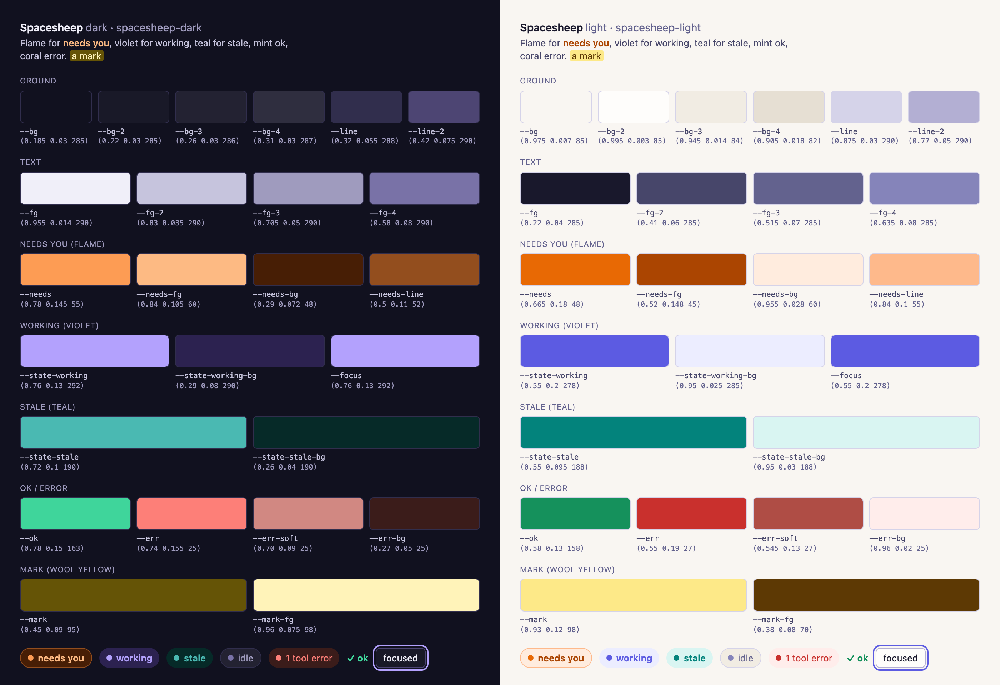

# Spacesheep color theme

Two color themes for the [sessionpipe GUI](https://github.com/spacesheep-dev/sessionpipe-gui),
one dark and one light, in the colours of [spacesheep](https://spacesheep.dev): the sheep's
flame for *needs you*, its indigo for *working*, teal for *stale*, mint and coral for ok and
error, the wool's yellow for a search mark, and a ground tinted toward the brand's violet.
A lot of colour, in the places the GUI already reserves for colour; everything a person
reads stays a near-neutral on a near-neutral, so an hour on the Board is no harder than on
the default scheme.



## Install

```sh
cp packages/color-themes/spacesheep-*.json ~/.local/state/sessionpipe-gui/color-themes/
```

(or, when it exists, `sessionpipe-gui color-theme add packages/color-themes/spacesheep-dark.json`).
The server reads the folder on every `GET /api/ui/color-themes`, so no restart: open the
quick settings (the gear on the rail or the tab bar) and pick **Spacesheep · dark** or
**Spacesheep · light** under *custom*. A color theme forces its scheme while applied.

## The palette

Every value is `oklch(L C H)`. Surfaces keep chroma ≤ 0.03; text tiers clear 7:1 (`--fg`,
`--fg-2`), 5:1 (`--fg-3`) and 3:1 (`--fg-4`) on `--bg`; `scripts/check.mjs` verifies all of
it and the token names against `packages/shared-types/color-theme.ts`.

| Role | Token | Dark | Light |
| --- | --- | --- | --- |
| Page | `--bg` | `0.185 0.03 285` violet-slate | `0.975 0.007 85` warm paper |
| Card | `--bg-2` | `0.22 0.03 285` | `0.995 0.003 85` |
| Inset / hover | `--bg-3`, `--bg-4` | `0.26 0.03 286`, `0.31 0.03 287` | `0.945 0.014 84`, `0.905 0.018 82` |
| Hairlines | `--line`, `--line-2` | `0.32 0.055 288`, `0.42 0.075 290` lavender | `0.875 0.03 290`, `0.77 0.05 290` lavender |
| Text | `--fg` … `--fg-4` | `0.955 0.014 290` → `0.58 0.08 290` | `0.22 0.04 285` → `0.635 0.08 285` |
| Needs you (flame) | `--needs` | `0.78 0.145 55` | `0.665 0.18 48` |
| | `--needs-fg` | `0.84 0.105 60` | `0.52 0.148 45` |
| | `--needs-bg`, `--needs-line` | `0.29 0.072 48`, `0.5 0.11 52` | `0.955 0.028 60`, `0.84 0.1 55` |
| Working (indigo) | `--state-working`, `-bg` | `0.76 0.13 292`, `0.29 0.08 290` | `0.55 0.2 278`, `0.95 0.025 285` |
| Stale (teal) | `--state-stale`, `-bg` | `0.72 0.1 190`, `0.26 0.04 190` | `0.55 0.095 188`, `0.95 0.03 188` |
| Ok (mint) | `--ok` | `0.78 0.15 163` | `0.58 0.13 158` |
| Error (coral) | `--err`, `--err-soft`, `--err-bg` | `0.74 0.155 25`, `0.70 0.09 25`, `0.27 0.05 25` | `0.55 0.19 27`, `0.545 0.13 27`, `0.96 0.02 25` |
| Focus ring | `--focus` | `0.76 0.13 292` | `0.55 0.2 278` |
| Mark (wool yellow) | `--mark`, `--mark-fg` | `0.45 0.09 95`, `0.96 0.075 98` | `0.93 0.12 98`, `0.38 0.08 70` |

`--work*`, `--stale*`, `--idle*` and `--done*` follow the same hues (working = indigo,
stale = teal, idle and done = the muted text tiers); `--shadow` stays `none`.

## Where the colour goes

- The house rule "amber is the only accent" is **replaced**, not stacked: the flame orange
  takes over every place amber lived (`--needs*`), and it is still the one hue that may be
  loud on a page. Indigo and teal only colour-code the views that ask for state colours
  (the canvas windows, the office figures) and the focus ring.
- Surfaces are the brand's neutrals (spacesheep's slate `#1c2028` pushed toward its violet;
  its paper `#f8f7f4`), capped at chroma 0.03 so a page never reads as a coloured sheet.
- Hairlines and the muted text tiers carry a lavender cast. That is where the dark theme
  gets its colour on the Board and the Feed, where nothing else is allowed to be coloured.
- No gradients; the token system has none.

## Origin

Read from the spacesheep clone (`assets/foundation/theme.ts`, `assets/media/brand/*.svg`,
`packages/app/src/pages/marketing.ts`, `design-explorations/_brand.md`), in oklch:

| spacesheep | hex | oklch |
| --- | --- | --- |
| brand indigo (fill, focus) | `#5a5ae6` | `0.55 0.206 277` |
| brand text, dark | `#b39dff` | `0.754 0.139 293` |
| flame: red → orange → amber → yellow | `#e5462e` `#f77000` `#faa000` `#fbcf00` | hues 32 → 48 → 70 → 93 |
| attention | `#f77000` / `#ff963f` | `0.697 0.189 48` / `0.77 0.159 56` |
| the logo's pixels | `#ed5544` `#fe7700` `#fea900` `#ffdf01` `#feed87` | hues 30 → 100 |
| tile teal | `#00756e` / `#5fd4c9` | `0.507 0.088 188` / `0.80 0.107 187` |
| success | `#2d8f5e` / `#34d399` | `0.581 0.118 157` / `0.773 0.153 163` |
| danger | `#cc4444` / `#ff8080` | `0.579 0.172 24` / `0.744 0.155 22` |
| paper / slate | `#f8f7f4` / `#1c2028` | `0.976 0.004 91` / `0.243 0.016 264` |

The sheep's cheek pink (`#d58e9e`) and the categorical set were left out: pink sits too
close to coral and orange to be a safe state colour, and a theme is not a chart palette.
No logo or wordmark is used; this is a colour theme, not a rebrand.

## Checking

```sh
node packages/color-themes/scripts/check.mjs
```

Validates each `*.json` the way the GUI's `parseColorTheme` does and prints every
text-on-ground ratio with its floor. Exit code 1 on any failure.
