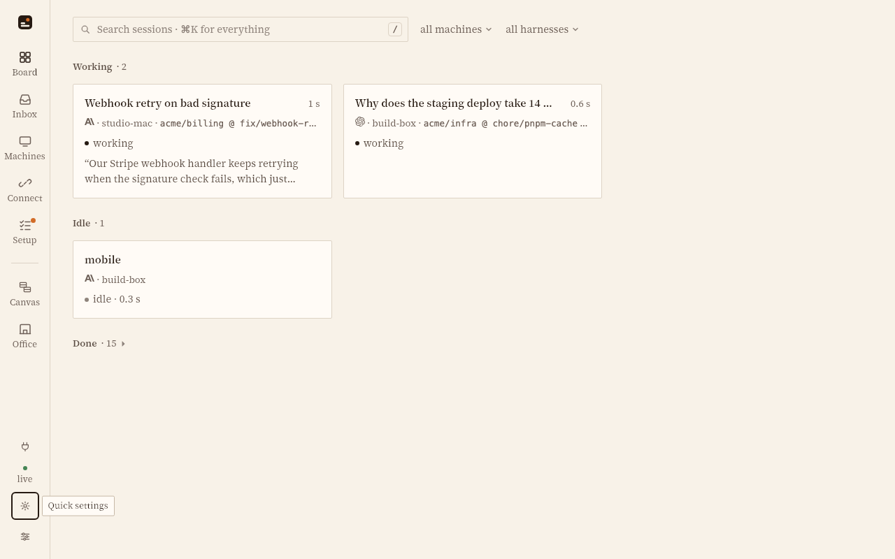

# Paper Serif · skin

A skin for the [sessionpipe GUI](https://github.com/spacesheep-dev/sessionpipe-gui) that
proves the parts of a skin a color theme cannot carry: a **bundled typeface** (Source
Serif 4, variable, roman and italic, under the SIL Open Font License), **shape** (corner
radius 2 px, one-pixel hairlines) and **density** (`comfortable`: rows 36 / 40 / 44 px),
on a warm paper palette with a terracotta accent for *needs you*. Light only.



```sh
sessionpipe-gui skin add  packages/skin-paper-serif
sessionpipe-gui skin link packages/skin-paper-serif     # a symlink, while editing
```

Then pick **Paper Serif** under *Installed* in the appearance popover (the gear on the
rail). The Appearance control is set to Light while it is on.

## What is in it

| File | What |
|---|---|
| `skin.json` | The manifest: tokens, the two `@font-face` entries, `typography.ui` with the serif first and system serifs after it, `typography.scale: 1.05` (the serif sets a little small), `shape`. |
| `fonts/SourceSerif4Variable-{Roman,Italic}.woff2` | Source Serif 4 4.005 by Adobe, weight axis 200–900, from the [release](https://github.com/adobe-fonts/source-serif/releases/tag/4.005R); `fonts/LICENSE-SourceSerif4.md` is the OFL. |
| `skin.css` | A few lines scoped to `html[data-skin="paper-serif"]`: headings and card titles a step heavier, no colours of its own. |
| `scripts/preview.mjs` | Renders `preview.png` with Playwright: links the skin into a scratch state dir, starts a GUI in demo mode on a spare port, picks the skin, screenshots the board. `npm run preview` (needs a built GUI checkout beside this repo, or `SPGUI_DIR`). It renders any package: `node scripts/preview.mjs ../skin-spacesheep-vivid`. |

`npm test` runs the token checker over the manifest. The format: `docs/skin-authoring.md`
in the GUI repo.
