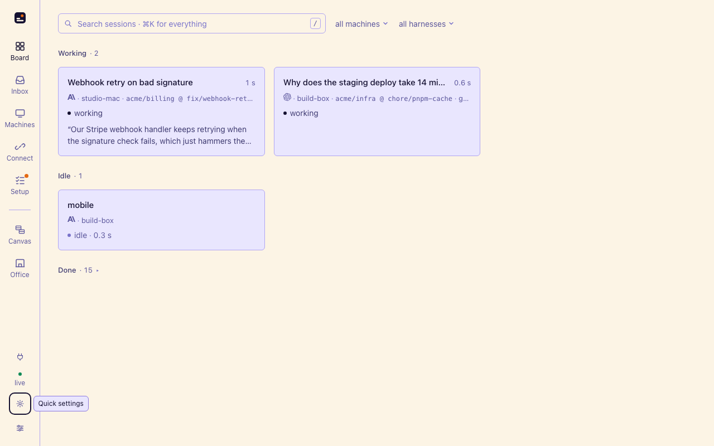

# Spacesheep Vivid · skin

The [Spacesheep Vivid color themes](../color-themes) as one **skin** for the
[sessionpipe GUI](https://github.com/spacesheep-dev/sessionpipe-gui): `scheme: "both"`, so
one entry in the appearance popover follows the system / dark / light setting with the
token sets from `spacesheep-vivid-dark.json` and `spacesheep-vivid-light.json`. Where the
built-in Spacesheep keeps its surfaces near-neutral, Vivid lets the cards carry the brand:
deep indigo on a violet-black page, soft lavender on warm cream, lavender hairlines, a
flame highlight for search marks.

```sh
sessionpipe-gui skin add  packages/skin-spacesheep-vivid
sessionpipe-gui skin link packages/skin-spacesheep-vivid     # a symlink, while editing
```

Then pick **Spacesheep Vivid** under *Installed* in the appearance popover (the gear on
the rail). No restart.



The palette and its ratios: [`../color-themes/README.md`](../color-themes/README.md),
"Vivid, where it differs". `npm test` runs the token checker over `skin.json`.
